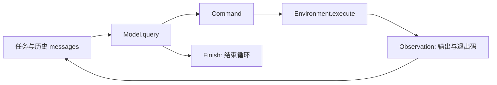

# mini-coding-agent

一个从零实现的教学版 **Agent harness**：用假模型串起 `Model → Environment → Agent Loop`，真实完成一次“读代码 → 复现失败 → 修改代码 → 测试通过 → 提交”的闭环。

假模型的修复方案由人预先写好。这个项目验证的是框架如何工作，不能用来证明模型的软件工程能力，也不提供 SWE-bench 评分。

## 先运行一次

运行环境：Python 3.12+、macOS / Linux、`/bin/bash`。运行和测试只使用 Python 标准库，无需 API key，也没有模型调用费用。

在项目根目录执行（已有的 `.venv/bin/python` 也可以替换下面的 `python3`）：

```bash
PYTHONPATH=src python3 -B -m mini_coding_agent
```

也可以通过项目已有的 uv 打包入口运行；首次使用 uv 可能需要下载构建工具：

```bash
uv run mini-coding-agent
```

每次演示会创建一个新临时目录并打印它的路径，保留两个真实的练习文件和完整轨迹，便于检查：

```text
mini-coding-agent-xxxx/
├── workspace/
│   ├── calculator.py       # 原先 return a - b，最终被修复为 return a + b
│   └── test_calculator.py  # 3 个测试；agent 不修改它
└── trajectory.json        # 任务、动作、输出、退出状态
```

你会看到以下五轮模型调用。中间的失败来自真实执行的 `unittest`，它是演示的一部分：

| 模型调用 | 模型返回 | 环境产生的反馈 |
|---|---|---|
| 1 | 读取源码和测试的命令 | 文件内容，退出码 0 |
| 2 | 运行测试的命令 | 3 个测试中 2 个失败，退出码 1 |
| 3 | 修改源码的命令 | 文件发生改变，退出码 0 |
| 4 | 再次运行测试的命令 | 3 个测试全部通过，退出码 0 |
| 5 | `Finish` | 不再执行命令，循环以 `submitted` 结束 |

可以指定一个**尚不存在**的输出目录；已存在时程序会拒绝覆盖：

```bash
PYTHONPATH=src python3 -B -m mini_coding_agent --output-dir /tmp/my-agent-lesson
```

也可以把步数设为 2，观察“测试失败后因预算耗尽退出”。这次命令退出码为 1，轨迹仍会保存：

```bash
PYTHONPATH=src python3 -B -m mini_coding_agent --max-steps 2
```

运行框架的测试：

```bash
PYTHONPATH=src python3 -B -m unittest discover -s tests -v
```

## 代码从哪里开始读

| 文件 | 负责什么 | 阅读时关注的问题 |
|---|---|---|
| [interfaces.py](src/mini_coding_agent/interfaces.py) | 数据结构与 `Model`、`Environment` 接口 | 组件之间传递什么？ |
| [agent.py](src/mini_coding_agent/agent.py) | 通用循环 | 执行反馈如何进入下一次模型调用？ |
| [environment.py](src/mini_coding_agent/environment.py) | 本地 shell 执行 | 谁真正读取和修改文件？ |
| [model.py](src/mini_coding_agent/model.py) | 内置练习的假模型 | 下一步动作是谁决定的？ |
| [demo.py](src/mini_coding_agent/demo.py) | 创建练习、装配组件、展示和保存结果 | 框架怎样变成一次完整运行？ |
| [tests/test_core.py](tests/test_core.py) | 闭环与边界行为验证 | 反馈、退出和隔离边界是否符合约定？ |

## 最小框架是什么

核心只有两个可替换接口，以及协调它们的循环：

```python
class Model(Protocol):
    def query(self, messages) -> Command | Finish: ...

class Environment(Protocol):
    def execute(self, action: Command) -> Observation: ...
```

`Protocol` 描述“对象需要有哪些方法”。实现类不必继承它，方法符合约定即可；它主要服务于阅读和静态类型检查，不会自动校验所有运行时数据。

`Agent.run()` 的主体可以缩写为下面这样；实际代码还处理了最大步数和返回状态：

```python
messages = [system_message, task_message]
while True:
    action = model.query(messages)
    messages.append(Message("assistant", action))
    if isinstance(action, Finish):
        break
    observation = env.execute(action)
    messages.append(Message("tool", observation))
```



真正值得学习的是这三个边界：**模型决定做什么，环境负责真实执行，Agent 维护反馈闭环和退出条件。** `while` 很短，但如果下一轮模型看不到上一步结果，就不能根据执行情况调整行为。

## 为什么这样设计

### 1. 让 Model 返回动作，不直接操作文件

这里的“Model”是模型适配器接口。假模型用 Python 规则给出动作，未来真实模型适配器可以调用模型 API，再把响应解析成动作。

例如 `Command("cat calculator.py")` 只是一份动作数据。返回它的瞬间，文件还没有被读取。只有 `Environment.execute()` 启动子进程之后，读取才真实发生。假模型没有持有工作目录，也不直接打开练习文件。

因此，更换模型提供方时，执行器和循环可以保持原样；更换执行环境时，模型仍然返回同一类动作。

### 2. 用一个命令工具完成读、改、测

读取可以用 `cat`，修改可以用一段 Python，验证可以用 `python -m unittest`。第一版不需要分别设计 `ReadFileTool`、`EditFileTool`、`TestTool`。

本地执行器返回 `Observation(output, returncode, timed_out)`。正常输出和错误输出都要回传；测试失败的非零退出码不应被框架误当成自身崩溃，否则模型恰好在最需要反馈时失去了反馈。

每次命令启动新 shell：**文件变化会保留，上一轮的 `cd`、`export` 不会保留。** 持续存在的是工作目录中的文件，而不是一个交互式终端会话。

本地执行器拥有当前进程的本机权限，`cwd` 只是工作目录，不是安全沙箱。演示使用我们写定的命令和新建的练习目录；如果要执行真实模型生成的任意命令，应先实现容器等隔离环境。

### 3. 历史既是上下文，也是可检查的轨迹

每轮记录两件事：模型决定的动作，以及环境实际返回的结果。下一轮传入完整历史，模型才能知道“我刚才做过什么、发生了什么”。最后的 `trajectory.json` 则让人能够检查全过程。

教学版使用不可变 dataclass 表示动作、观察和消息，并把历史的 tuple 快照交给模型，减少意外改写记录的可能。这是内部数据格式，不是任何模型厂商的 API 消息格式。

### 4. 假模型有固定剧本，但必须检查真实反馈

`FakeModel.query()` 根据历史中 observation 的数量选择阶段，并检查最近一次反馈：

- 读取阶段必须看到预设的 `return a - b`。
- 复现阶段必须看到 `test_add` 的断言失败。
- 修改命令必须正常退出。
- 验证阶段必须看到成功退出和测试输出 `OK`，才返回 `Finish`。

这是一段**带条件检查的预设决策程序**，不会理解任意用户任务，也不会推理新修复方案。它遇到非预期结果会抛出异常。测试中还模拟了“修改命令退出码为 0，但实际上没有改代码”，确保假模型不会跳过最终验证而宣称成功。

“读 → 测 → 改 → 测”只存在于这个假模型里，`Agent` 没有写死这套流程。真实模型可以连续搜索多次，或者在测试失败后继续修改；循环无需知道具体策略。

### 5. 明确区分提交、耗尽预算和正确性

| 结果 | 含义 |
|---|---|
| `submitted` | 模型返回了 `Finish`，主动提交结果 |
| `step_limit` | 模型调用达到上限，仍未提交 |
| Python 异常 | 教学模型遇到非预期情况，或组件实现出错；直接暴露异常 |

`max_steps` 数的是模型调用次数，最后一次 `Finish` 也占一次。因此正常演示需要 5 次模型调用和 4 次命令执行。

**模型停止不等于答案正确。** `Agent` 不会验证 `Finish` 的声明。这个示例里的三条测试只是可见验证；如果将来跑 SWE-bench，还要把生成的 patch 交给它的独立评测 harness。

## 与官方 mini-swe-agent 的对应关系

以下对应关系依据 2026-11-06 查阅的官方 `main`，其源码版本为 `2.4.6`。链接指向会继续变化的官方分支。本项目借鉴组件边界，采用自己的精简实现，并不与官方 API 或轨迹格式兼容。

| 本项目 | 官方源码入口 | 对应与区别 |
|---|---|---|
| `Model` / `Environment` Protocol | [minisweagent/__init__.py](https://github.com/SWE-agent/mini-swe-agent/blob/main/src/minisweagent/__init__.py) | 官方同样用 Protocol 描述契约，还包含配置、消息格式化和序列化方法 |
| `Agent.run()` | [agents/default.py](https://github.com/SWE-agent/mini-swe-agent/blob/main/src/minisweagent/agents/default.py) | 官方由 `run → step → query / execute_actions` 完成闭环，并管理预算、异常和保存 |
| `FakeModel` | [models/test_models.py](https://github.com/SWE-agent/mini-swe-agent/blob/main/src/minisweagent/models/test_models.py) | 官方的 `DeterministicModel` 按序返回预设响应；本项目额外检查执行反馈，便于演示闭环 |
| 未来的真实模型适配器 | [models/litellm_model.py](https://github.com/SWE-agent/mini-swe-agent/blob/main/src/minisweagent/models/litellm_model.py) | 官方通过 API 调用模型，并解析动作、统计费用、格式化工具反馈 |
| `LocalEnvironment.execute()` | [environments/local.py](https://github.com/SWE-agent/mini-swe-agent/blob/main/src/minisweagent/environments/local.py) | 官方同样执行命令、收集输出/退出码，并处理超时和提交信号 |
| `demo.main()` | [run/hello_world.py](https://github.com/SWE-agent/mini-swe-agent/blob/main/src/minisweagent/run/hello_world.py) | 都负责装配 model、environment、agent，再启动任务 |

阅读官方代码时，需要留意三处有意简化：

1. **动作格式不同。** 本项目每轮返回一个 `Command` 或 `Finish`。官方 v2 的模型适配器返回消息字典，把解析后的动作放在 `message["extra"]["actions"]` 中；一轮可以包含多个动作。不要把“每轮只能一个命令”当作官方当前实现的限制。[官方模型实现](https://github.com/SWE-agent/mini-swe-agent/blob/main/src/minisweagent/models/litellm_model.py)
2. **反馈格式化的位置不同。** 本项目直接把 `Observation` 放进内部 `Message`。官方让模型适配器通过 `format_observation_messages()` 生成相应的工具结果消息，适配不同模型协议；循环负责把它们加入历史。[官方控制循环](https://github.com/SWE-agent/mini-swe-agent/blob/main/src/minisweagent/agents/default.py)
3. **结束机制不同。** 本项目用显式 `Finish`。官方本地执行器检测成功命令输出首行的 `COMPLETE_TASK_AND_SUBMIT_FINAL_OUTPUT`，抛出携带提交信息的 `Submitted`；循环处理后，以最后一条消息的 `role == "exit"` 判断退出。[官方本地执行器](https://github.com/SWE-agent/mini-swe-agent/blob/main/src/minisweagent/environments/local.py)

因此，我们学的是可迁移的职责划分和反馈机制；官方配置、消息协议与控制细节仍应以源码为准。

## 如何从这里逐步扩展

按每一步要解决的问题推进，不必一次引入所有能力：

| 阶段 | 需要新增的能力 | 放在哪里 | 怎么判断做对了 |
|---|---|---|---|
| 当前版本 | 假模型、真实命令、反馈、明确退出 | 三个核心组件 | 看见失败 → 修复 → 通过，反馈异常时不虚报成功 |
| 1. 执行隔离 | 容器中的工作目录、命令执行和清理；将假模型的 Python 路径改为可配置 | 新 `DockerEnvironment.execute()` | 同一决策脚本可在容器中完成练习，宿主工作文件不受修改 |
| 2. 接入真实模型 | 请求模型 API，将文本或 tool call 解析成动作，把历史编码成模型消息 | 新 `ApiModel.query()` 及适配方法 | 替换假模型即可运行；循环不包含供应商判断 |
| 3. 处理真实失败 | 格式错误反馈、API 重试、输出截断、调用费用/时间预算 | 按职责分别放入模型、环境、循环 | 畸形回复、超长输出和失败重试都有明确结果 |
| 4. 让运行可追查 | 每轮落盘、异常时保留轨迹、配置记录；按需增加人工确认 | 循环的保存点、外围 runner | 中途出错仍可看到出错前的动作与输出 |
| 5. 接入基准 | 加载题目、准备干净仓库、收集 diff、批量执行 | 独立 benchmark runner | 生成合规 predictions，再交给独立 evaluator 得到成绩 |

当前不做真实模型请求、通用输出解析、容器、长期记忆、多 agent 或 SWE-bench 集成。命令输出和历史暂不截断；轨迹仅在正常提交或步数耗尽后写盘，模型/基础设施异常会直接抛出。保留这些边界，能先把最小闭环读懂，再逐项扩展。
